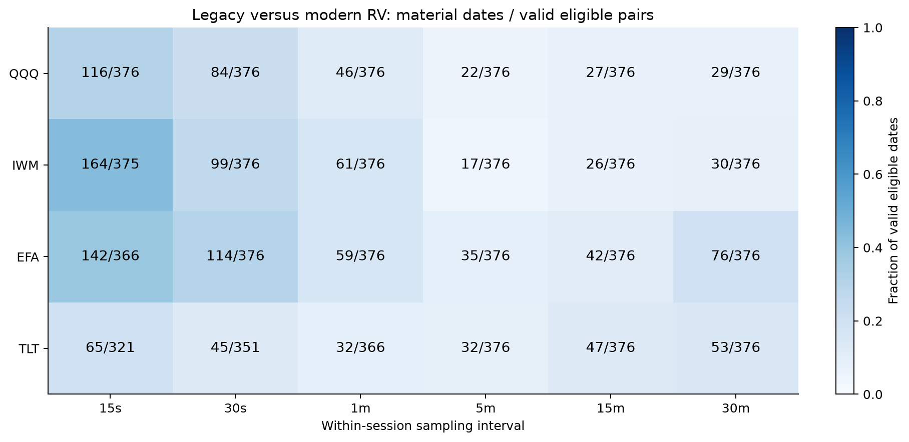
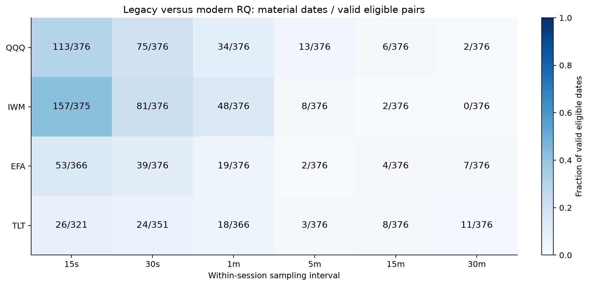
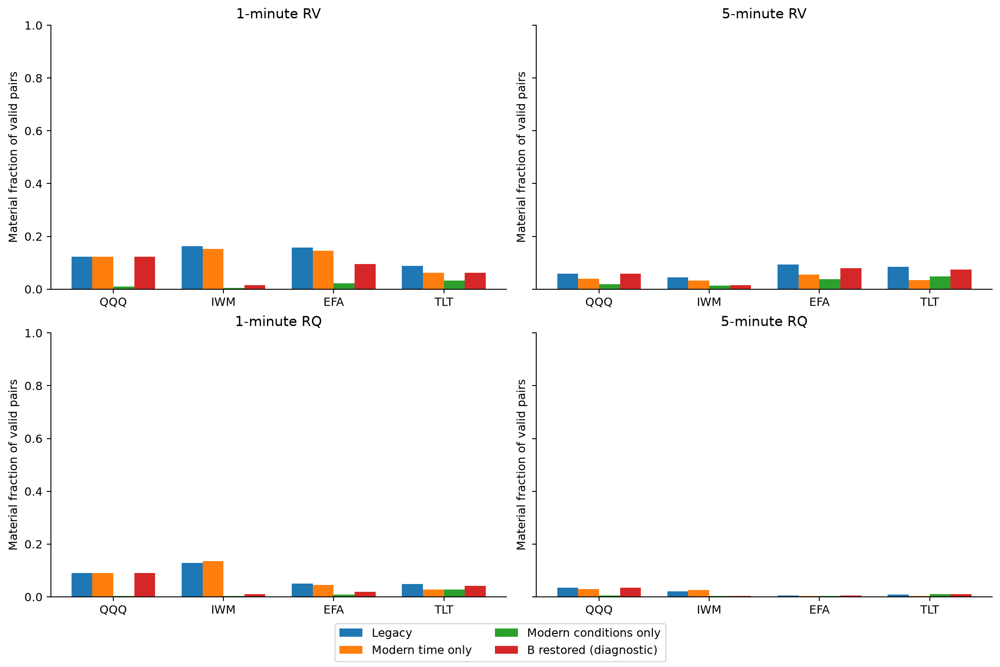
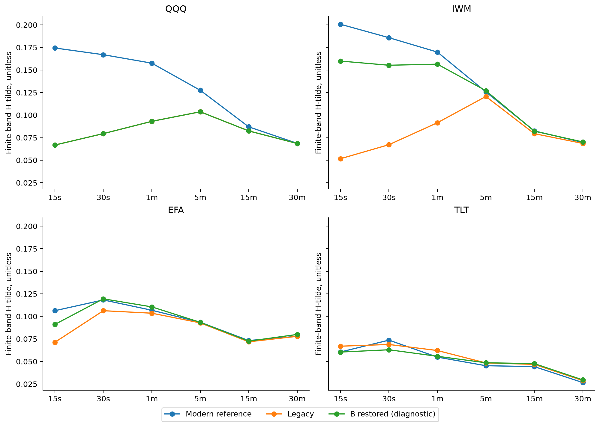
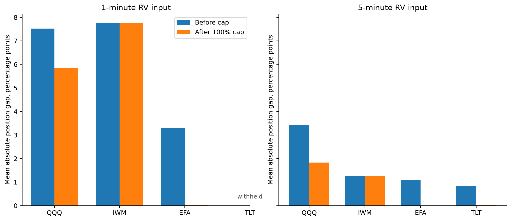
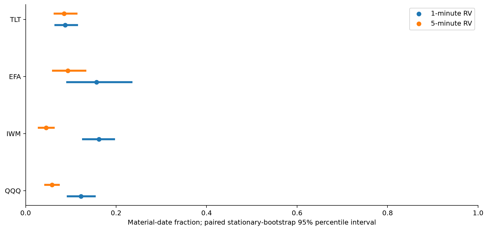

# A13: fixed four-fund breadth extension

Analysis: etf_breadth_analysis_20261022T144854Z. Independent check: etf_breadth_independent_check_20261022T145028Z. Export: etf_breadth_export_verified_20261022T144522Z.

Acquired 1,508 new paired fund-days and reused 84 previously observed January 2014 pairs: 1,592 total, 398 sessions per fund. Primary incidence has 376 eligible dates per fund before grid missingness. The fixed funds/window are QQQ, IWM, EFA, TLT over 2013-01-02 through2014-07-31. January 2014 and the fixed discovery dates are excluded from primary incidence. Full-calendar H/risk histories include them and are explicitly descriptive.

## Complete headline comparison: legacy versus modern

RV materiality: ratio outside [1/1.1,1.1]. RQ: outside [1/2,2]. Counts use valid eligible pairs; missing denominators are retained below. Gaps are percentage points of portfolio weight, not percentages of returns. The policy is fixed and does not evaluate returns.

| Fund | Grid, min | RV hits/valid | RQ hits/valid | Mean capped gap, pp | Mean uncapped gap, pp | Origins with gap>=5pp |
|---|---:|---:|---:|---:|---:|---:|
| QQQ | 1 | 46/376 | 34/376 | 5.8531 | 7.5218 | 133 |
| QQQ | 5 | 22/376 | 13/376 | 1.8268 | 3.4166 | 50 |
| IWM | 1 | 61/376 | 48/376 | 7.7539 | 7.7539 | 186 |
| IWM | 5 | 17/376 | 8/376 | 1.2386 | 1.2394 | 9 |
| EFA | 1 | 59/376 | 19/376 | 0.0109 | 3.2885 | 0 |
| EFA | 5 | 35/376 | 2/376 | 0.0101 | 1.0874 | 0 |
| TLT | 1 | 32/366 | 18/366 | withheld | withheld | withheld |
| TLT | 5 | 32/376 | 3/376 | 0.0157 | 0.8150 | 0 |

## Interpretation boundaries

Every fund, grid and construction is reported in the accompanying tables; zero effects and missing values remain. This follow-up shares the SPY historical source regime and known prior results. It broadens asset coverage but is not untouched chronological validation, an independent-fund experiment, a profitability backtest or evidence identifying latent roughness. The original longer forecast study remains deferred. A large cap-masking percentage must be read with its underlying absolute gap. Crossed-condition comparisons diagnose this exact pipeline, not a universal trade filter.

The independent checker recalculated 6445 scalars using separate incidence/slope/convolution arithmetic and a restart-segment bootstrap, including a planted altered incidence. Export hashes, independent exchange hours, all 1,592 pairs and daily measurement/correspondence checks passed. These checks do not certify provider semantics, economic truth or independent human review.

## Figures and complete tables

All four funds and all six grids. Primary sample excludes already observed January 2014 and fixed discovery dates. RV materiality factor is 1.1; reciprocal lower boundary. Missing pairs do not count as agreement. Each cell reports its denominator.

All four funds and all six grids. Primary sample excludes already observed January 2014 and fixed discovery dates. RQ materiality factor is 2.0; reciprocal lower boundary. Missing pairs do not count as agreement. Each cell reports its denominator.

All fixed crossed constructions at 1/5 minutes; full numeric denominators and all other grids are in the incidence table. Component effects can interact through selection, venue choice and medians. B restoration remains diagnostic.

Descriptive lags 1-10 over the full 398-session calendar, including already observed January/discovery dates. Gaps retain calendar endpoints. Source-comparison slopes with common endpoint support, and bands 5/22, are included in the full H table. No latent-H inference.

Fixed lambda .94,10% annual volatility target,100% exposure cap,126-session warmup; 272 dependent origins if histories are complete. Compare raw gaps as well as attenuation percentages: a large attenuation of a tiny gap is not a large economic effect. No returns or profitability evaluated.

Primary mean-date block 22, 3,999 draws. The same resampled calendar indices are shared across every fund/construction/grid; 11/44 sensitivities are fully reported. Intervals are exploratory, assumption-dependent and not corrected simultaneous comparisons. Funds are not independent replications.

Tables: A13_incidence.csv (all 120 rows), A13_H.csv (360), A13_risk.csv (120), A13_intervals.csv (720). Proprietary daily observations remain excluded.
