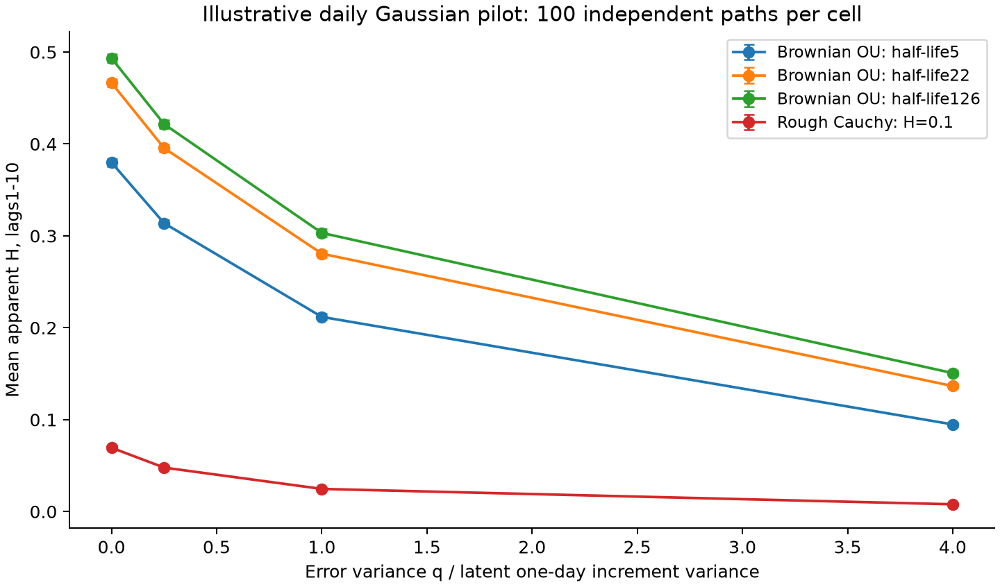
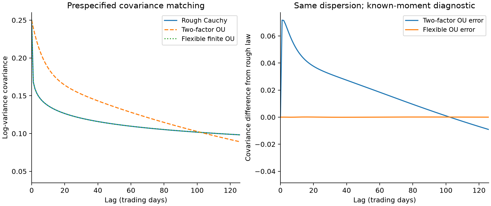
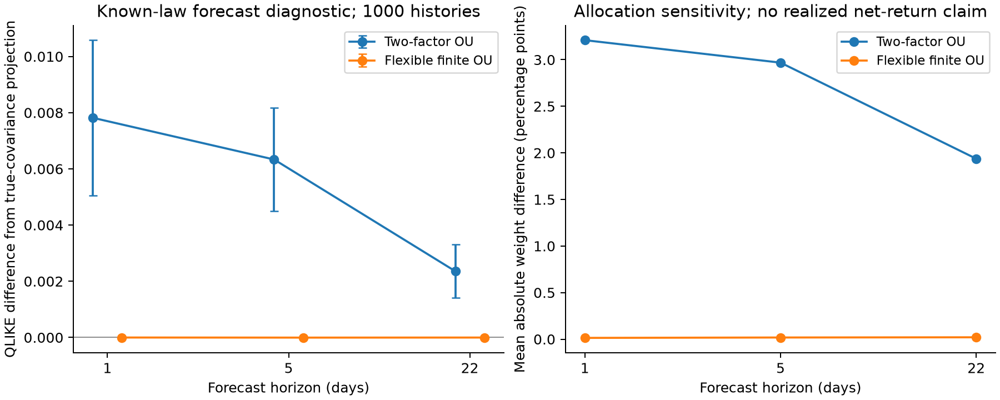

# Executed preparation and pilot checkpoint

Independent research, 20 October 2026. **This is not a production study, empirical mechanism identification or publication-ready manuscript.** The scientific gates and exact continuation point are in STATUS.md and checkpoint.json.

## What actually ran

| Work | Evidence | Scope |
|---|---|---|
| Formula notebook | formulas_20261020T210146Z |8 code cells executed with analytical and numerical checks |
| Daily Gaussian grid | pilot_20261020T204559Z |1400 independent latent paths; 62 observation cells; 100 paths per cell; 18600 lag-band estimates |
| Efficient-price construction | efficient_20261020T204744Z |100 Brownian OU paths of 250 sessions, 1560 steps/session, nested 1/5/15/30 minute sampling |
| Covariance/power diagnostic | covariance_20261020T205535Z |1000 independent projection histories; 1250-dimensional Gaussian power calculation; 1000 null calibration+100 evaluation paths per law |
| Forecast baselines | baseline_20261020T205304Z |225000 forecasts over 100 independent OU paths, 3 models, 3 horizons, 250 origins; 0 positivity/maturity failures |
| Dependence-aware mock | inference_20261020T205351Z |30 independent AR1 series; 4999 stationary bootstrap draws each; mean block 44 |
| Published Table 1 replication | replication_patton_20261020T204503Z |27 prespecified theoretical cells from Patton 2011 |
| Secondary preprint formula audit | mouti_audit_20261020T205609Z |48 deterministic finite-band fOU cells from Mouti 2026 |
| SPY data audit | data_audit_20261020T211210Z |750 development observations, 2014-2016; 745 validation observations quarantined; 0 final-test observations acquired |

The source register distinguishes original 24 draft entries, acquired bytes, working-paper/journal identity and targeted inspection. Eighteen evidence cards and a novelty matrix accompany the positioning memo. Downloaded code was not executed.

## Main illustrative findings

**Finite-band scaling is not local regularity.** For half-life 22 Brownian OU with 1250 daily observations, mean naive H on lags 1-10 was 0.46644 (Monte Carlo SE 0.00215) without observation noise. Its population finite-band slope is 0.46987, already below 0.5. With q/m_X(1)=1, mean naive H fell to 0.28063, while known-iid-noise subtraction gave 0.46803. At ratio 4 the naive mean was 0.13661. These are specified Gaussian daily experiments, not estimates of market spot H. Negative corrected moments and nonlinear-fit boundary hits remain in the tables.

**A flexible nonrough control changes the interpretation.** The fixed finite OU dictionary matches the chosen rough Cauchy daily covariance with maximum absolute error about 0.000104141 over lags 0-126, against stationary variance 0.25. A fixed two-factor alternative fits substantially worse. This is known-moment matching, not parameter estimation on historical data.

For 1250 observations with common q=2/78, D_KL(rough||flexibleOU)=0.00144005. Independent trace/logdet and whitened-eigenvalue calculations differed by 8.66e-15. Pinsker's inequality gives a computed upper power bound 7.68% for any exact-size 5% test between these two known Gaussian laws. The independently evaluated likelihood-ratio test rejected 6.0% under the null and had 8.0% power (MCSE 2.71 percentage points). Threshold-calibration uncertainty is additional. This demonstrates one low-power finite-grid pair; it is not a universal impossibility theorem.

At h=1, the flexible-OU minus true-covariance projection QLIKE difference was -1.4962741e-06 with paired Monte Carlo SE 5.6541224e-06. Mean absolute exposure difference was 0.01377 percentage points. These small values do **not** establish practical equivalence: no numerical equivalence margin is registered. No net CE or realized trading result is reported.

**Observation layers matter.** In Level B, exact stationary OU is simulated at grid nodes; IV/price integrals are left-point approximations. The maximum path-average relative difference between 1560- and 780-step IV constructions was 4.99931e-05, below the prespecified 0.001 gate. Nested sampling errors are correlated. This validates the Brownian construction only; a rough spot-to-IV version remains open.

## Replication agreement and discrepancies

Patton's published Table 1: **25/27 cells** meet the tolerance 0.015 fixed before execution. The two failures are MAE-prop under t 6 and t 10: exact numerical optima 2.821602 and 2.580113 versus printed 2.73 and 2.55. The source footnote calls these entries numerical approximations. Independent moment quadrature and closed forms agree to numerical precision for checked quantities. No tolerance was widened after seeing results. See `results/patton_table1_replication.csv` and `configs/replication_patton.json`.

Mouti preprint Table 2: **35/48 cells** meet tolerance 1e-4; maximum absolute H discrepancy 0.0049424. The Brownian limiting case agrees with exact OU to 7.59e-12. An independent oscillatory covariance transform agrees with the separate variogram-integral method in checked cells. The cause of larger-lag table differences remains unresolved. This is a secondary preprint audit, not the published replication.

During source inspection, S09 PDF page 22 printed a plus sign in a stationary Gaussian conditional-variance expression that requires a minus. The source page was visually checked. We have not inspected the authors' executed code, so no claim is made that its numerical results used the printed expression. Our code uses and tests the conditional minus.

## Data pilot and limits

The maintainer-distributed SPYRM snapshot contains 1495 dates, 2014-2019, including 1/5 minute RV, RQ, BPV, median measures, kernels and a last-recorded CLOSE. Our audit covers 750 development observations through 2016. It found 0 duplicate dates and 756 expected XNYS sessions. All six missing dates are early closes, verified against the installed exchange calendar. They remain missing; no imputation or ordinary adjacent-day lag interpretation is imposed.

RQ/RV^2 scale diagnostics are inconsistent with simply treating the raw RQ fields as decimal-return quarticity. Dividing RQ by 1e8 is only a candidate conversion, not a source-verified correction. Exact M, session definition and upstream rights remain unresolved. Therefore no empirical q calibration, HARQ fit, latent H inference or implementable economics was run. See `data/DATA_CARD.md`, `results/data_quality.json`, field mapping and acquisition manifest.

[Local SPY pilot figure](../results/figures/SPY_pilot_audit.png) (generated locally; omitted from Git pending upstream data-rights verification).

VOLARE requires a login; no entitlement was verified. The official Shi-Yu-Zhang data archive was identified but returned 403 locally. No credentials were entered or restrictions bypassed. No 2020-2025 market data were acquired; final-test boundaries are unchanged.

## Readiness and next action

All 15 scientific tests passed, including joint date resampling and independent KL forms; notebook execution, covariance and Brownian refinement checks passed. The inference mock covered the known mean on 80% of 30 independent series at nominal 90%, with 7.30 percentage-point Monte Carlo SE. This is insufficient to certify coverage. G0/G2/G3 remain partial and G4 has not passed. No production run was launched.

Next execute `python scripts/validate_checkpoint.py`, then resolve source-supported RQ units and session counts and validate rough spot-to-IV integration. Only after calibrated H inference, comparable estimated structural fits, fixed margins and aligned execution accounting should the final protocol be frozen and the final test opened.
