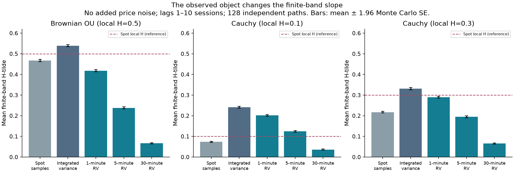
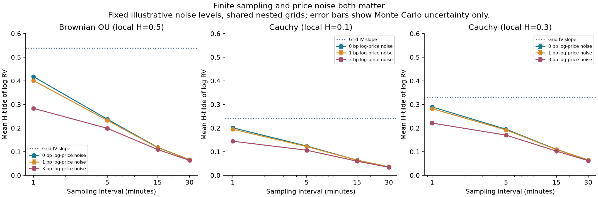
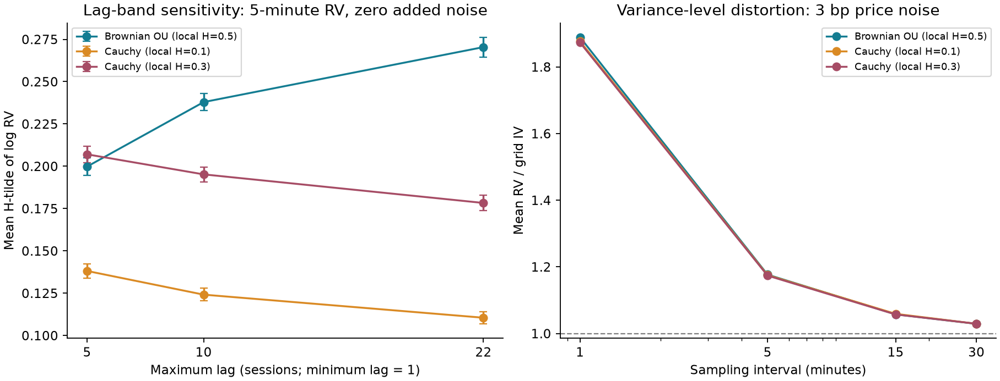

# Rough or Just Noisy? — a reproducible simulation study

Independent side project by Martin Valachy, with disclosed AI assistance. Version 1: replication and sensitivity analysis, not a novelty claim or completed forecasting study.

## Result

The same volatility model produces different finite-band slopes depending on whether we observe spot samples, integrated variance or realized variance. In the fixed Brownian OU experiment, spot local H is 0.5, but 5-minute log-RV has mean H-tilde **0.238** (Monte Carlo SE **0.0026**), even without added price noise. Coarser sampling further lowers the descriptive estimate in these scenarios. This establishes a controlled counterexample to identifying spot roughness from a naive RV slope. It does not identify the latent roughness of market volatility.

## Design, frozen before the run

Run `side_project_study_20261021T214152Z`; config `configs/side_project.json`; source `src/roughnoisy/study.py`; amendment A08. Three stationary Gaussian log-spot-variance models: Brownian OU and generalized Cauchy with local H=0.1/0.3, beta=0.5. Common stationary log variance 0.25, half-correlation time 22 trading days, mean daily variance 0.0001. The Cauchy process is not fractional OU.

128 independent paths per model, 504 sessions each, 780 steps/session (30-second trading-clock intervals). Set v=0.0001 exp(X-0.25/2); approximate daily IV by the mean of the left-point v values. Conditional fine log-price increments are independent Gaussian with variance v/780. Price shocks are independent of volatility. There are no overnight periods, jumps, leverage or quote dynamics. The model is a driftless log-price experiment, not a fitted return or trading model.

Sum fine log returns before squaring on nested 1/5/15/30-minute grids. RV=sum(r²), RQ=M/3 sum(r⁴); qhat=2RQ/(M RV²) is only a finite-sampling diagnostic. Add iid log-price noise with SD 0, 1 or 3 basis points on the fine price grid, sharing the same noise and efficient-price path across nested samples. These noise settings are illustrative, not calibrated to equities.

For each path, compute the mean squared increments of log spot variance, log grid IV or log RV at lags 1 through 10 sessions. H-tilde is half the OLS slope of log variogram against log lag. Sensitivities use bands 1–5 and 1–22. Local H, the finite-band spot slope, and the IV/RV slopes are different quantities. No classification test or confidence interval for market H is constructed.

## Main table

Zero added price noise; lags 1–10. Entries are means of path estimates, not slopes of pooled moments.

| Process | Spot samples | Grid IV | RV 1 min | RV 5 min | RV 30 min |
|---|---:|---:|---:|---:|---:|
| Brownian OU (local H=0.5) | 0.467 | 0.539 | 0.418 | 0.238 | 0.066 |
| Cauchy (local H=0.1) | 0.074 | 0.241 | 0.201 | 0.124 | 0.036 |
| Cauchy (local H=0.3) | 0.217 | 0.331 | 0.290 | 0.195 | 0.065 |

Integration raises the finite-band slope here; return sampling lowers it. Neither operation preserves the spot local exponent as a naive daily RV regression target. A coarse sampling interval reduces the number of returns and increases finite-sampling variation, even when prices have no added observation noise. With added iid price noise, finer sampling also inflates the RV level. No universal optimal frequency is inferred.

## Verification and numerical resolution

The pilot used four paths/model before the fixed full run. The covariance implementation passed an independently parameterized formula, inverse-spectrum implied covariance, and dense Cholesky Monte Carlo checks. Existing OU analytic and Gaussian embedding tests provide separate controls. RV/RQ from summed increments agree with an independent cumulative-price sampling construction. Constant-volatility tests check E[RV]=IV, E[RQ]=IV² and E[qhat]=2/(M+2), and verify endpoint-noise inflation.

For the full experiment, the maximum cell error relative to the exact conditional expectation E[RV|v]=grid IV+2M noise_SD² was **0.1978%**. This is a check of mean RV, not a proof of all distributional properties.

A separate coupled step-doubling diagnostic used 16 paths/model and 1560 versus 780 steps/session, with an independent centered-cross-product slope implementation. Maximum absolute path change in the IV slope was **0.000815**, below the preset 0.03 path tolerance; all mean changes were below 0.01. Run `side_project_refinement_20261021T214206Z`. This supports the stated grid resolution for this diagnostic, not exact continuous-time integration.

Monte Carlo SEs use independent paths as units. Within-path days, frequencies and lags are dependent. Error bars are mean ±1.96 Monte Carlo SE; they describe simulation precision, not estimator coverage or market uncertainty.

## Interpretation and limits

The result replicates and illustrates an established measurement issue. It neither proves that market volatility is smooth nor refutes rough volatility models. Observation-aware inference can still support roughness; no claim is made that accounting for noise must recover H=0.5. The result is conditional on three fixed Gaussian models, one persistence/marginal-variance setting, artificial noise, a finite trading clock and the chosen lag bands. There is no forecasting superiority, trading-profitability, calibrated identification power, equivalence or market latent-H claim. The larger registered forecast study remains deferred and its original boundaries are unchanged.

## Reproduce

From the repository root: `python -m pip install -e ".[demo]"`; `python -m pytest tests/test_science.py tests/test_study.py -q`; `python scripts/run_study.py --pilot` for a short check, then `python scripts/run_study.py` for the fixed experiment; `python scripts/check_study_refinement.py`; `python scripts/build_side_project.py`. The demo notebook provides a smaller executable walk-through. All these paths are synthetic-only and require no account or vendor data. Generated run IDs/timings differ; compare numerical outputs with tolerances. The full run on the recorded local environment took 88.1 seconds; this is not a runtime guarantee.

## Literature and attribution

- Cont and Das, *Rough volatility: fact or artefact?* (2024 journal publication; author version https://arxiv.org/abs/2203.13820): realized proxies can display apparent roughness under nonrough spot dynamics. Our naive slope is not their normalized-variation estimator.
- Fukasawa, Takabatake and Westphal, *Is Volatility Rough?* (author version https://arxiv.org/abs/1905.04852): estimation error can create misleading scaling; their observation-aware method still finds empirical roughness.
- Bennedsen, Lunde and Pakkanen, *Decoupling the short- and long-term behavior of stochastic volatility* (2022): generalized Cauchy covariance and separation of short-lag roughness from persistence. The existing source card and pinned source version document the equation used here.

AI assistance: code, analysis, checks and drafting were produced with Codex under Martin's direction. Automated independent checks are recorded; independent human review is not claimed. See AI_USE.md. This synthetic report contains no market observations or restricted data.
